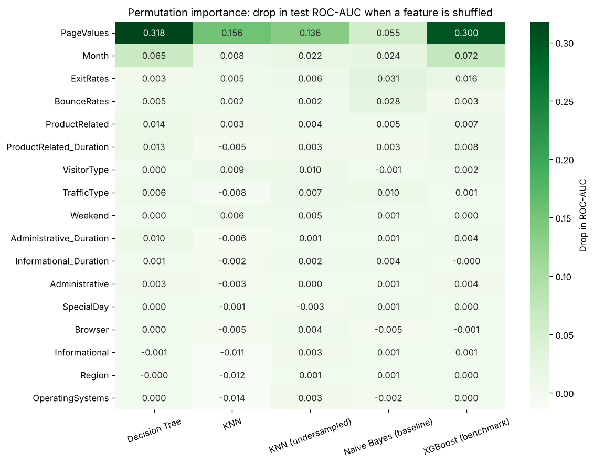
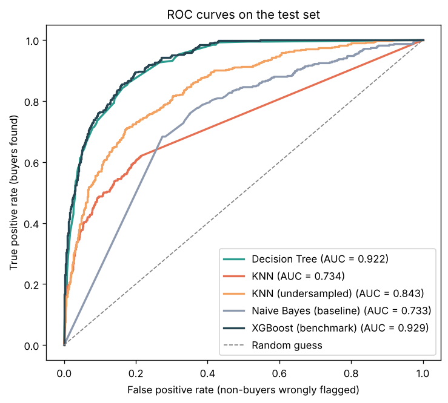
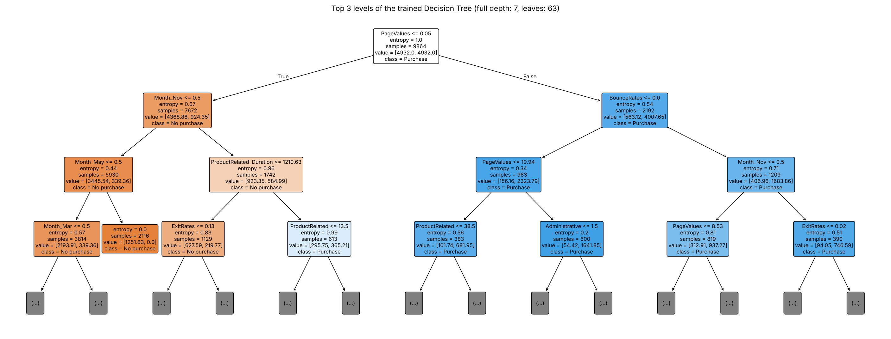

<div align="center">

<h1>Predator</h1>

<p>Predicts whether an online shopping session ends in a purchase, and explains which behaviours drive the prediction.<br>Decision Tree and KNN, a Naive Bayes baseline and an XGBoost benchmark, with a profit-based decision threshold and a Streamlit demo.</p>

<p>
<a href="https://github.com/pxnz3r/Predator/actions/workflows/ci.yml"></a>

<a href="LICENSE"></a>
<a href="https://predator.streamlit.app"></a>
</p>

<p><a href="https://predator.streamlit.app">Live demo</a> · <a href="https://www.kaggle.com/code/YOUR_KAGGLE_USERNAME/predator-purchase-prediction">Kaggle notebook</a> · <a href="docs/results.md">Results</a> · <a href="docs/methodology.md">Methodology</a> · <a href="docs/model_card.md">Model card</a></p>



</div>

## How it works

1. **Load and check** 12,330 real browsing sessions (17 features, 15.5% buyers) and explore them.
2. **Train** a Decision Tree, KNN (with and without undersampling), a Naive Bayes baseline and an XGBoost benchmark, each tuned with 5-fold stratified cross-validation on F1, inside a leak-free scikit-learn pipeline.
3. **Test how sure the scores are** with bootstrap confidence intervals, McNemar's test, per-group slices, and learning and validation curves.
4. **Explain** the models with tree importance, permutation importance, partial dependence and an ablation that retrains everything without `PageValues`.
5. **Pick a threshold** that maximises the profit of sending discount offers, check how it moves with the assumptions, and calibrate the probabilities so the threshold has a meaning.
6. **Study the mistakes** and **try it live** in the Streamlit app or from the command line.

## What you get

**One command for the whole study.** `python main.py` runs every step in about 4 minutes on a 4-core machine and writes 23 figures and 21 result files to `outputs/`.

**Honest evaluation.** Preprocessing is fitted on training data only, the best model and thresholds are chosen on cross-validation, and the test set is used once.

**Explanations, not just scores.** Every model is compared on the same 17 features, the Decision Tree is drawn, and the app prints the exact path of questions the tree asked for any session.

**A business angle.** Illustrative profit assumptions sit at the top of `predator/threshold.py`. The app has them as inputs and re-tunes the threshold live; a sensitivity grid shows how far it moves.

**Limits stated up front.** A [model card](docs/model_card.md) covers intended use, per-group performance and risks, including whether `PageValues` leaks the answer.

**Readable code.** Plain functions with docstrings and comments that explain the AI concepts as they come up: entropy and information gain, distances and scaling, the Naive Bayes assumption, boosting, cross-validation, data leakage and thresholds.

## Results

Test set (2,466 sessions), threshold 0.5. The best model is chosen by cross-validated F1.

| Model | Role | CV F1 | Precision | Recall | F1 | ROC-AUC |
|---|---|---|---|---|---|---|
| Decision Tree | Main | 0.642 | 0.512 | 0.806 | 0.627 | 0.922 |
| KNN | Main | 0.493 | 0.576 | 0.395 | 0.469 | 0.734 |
| KNN (undersampled) | Main | 0.521 | 0.401 | 0.728 | 0.517 | 0.843 |
| Naive Bayes | Baseline | 0.299 | 0.173 | 0.974 | 0.293 | 0.733 |
| **XGBoost** | **Benchmark (beyond the course)** | **0.673** | 0.545 | 0.791 | **0.645** | **0.929** |

95% bootstrap intervals: Decision Tree F1 0.590 to 0.661, XGBoost 0.609 to 0.679. They overlap, but McNemar's test on the same sessions says XGBoost makes fewer mistakes (p = 0.004).

<p align="center">


</p>

## What drives purchases

**PageValues decides most predictions.** It is the top feature for every model, the Decision Tree's first split (`PageValues <= 0.05`), and 56% of sessions with PageValues above 0 buy, against 3.9% of the rest. Removing it costs the tree models a third or more of their F1.

**Season comes second.** November has the highest purchase rate (25%) and is the second most important feature for the tree models; February is lowest (1.6%).

**Behaviour fills in the rest.** Without PageValues, the models fall back on exit rate, time on product pages and visitor type. They help (XGBoost still reaches ROC-AUC 0.77) but cannot replace it.

**The Decision Tree is the recommended course model.** It reaches 97% of the XGBoost benchmark's F1 and stays fully readable. Its validation curve peaks at depth 1 to 2 (CV F1 0.667): almost all of its skill is the PageValues split.

**PageValues may leak the label.** It is computed from purchases that followed each page; if those include the session's own purchase, the full scores are optimistic. Without it the tree drops to F1 0.384, so live performance likely lies between the two.

**0.5 is not the best cutoff.** With an $18 gain per caught buyer and a $6 cost per wasted offer, the Decision Tree earns most at 0.70 and targets a quarter fewer sessions. Across other plausible costs and boosts the best threshold ranges from 0.13 to "send no offers".

**Raw probabilities are inflated.** Class weighting pushes the tree's average probability to 0.28 against a real rate of 0.155. After isotonic calibration its Brier score falls from 0.109 to 0.072, and the plain break-even rule (offer when p > 0.25) earns $4,086 on the test set.

**Missed buyers look like browsers.** 80% of the buyers the best model misses have PageValues = 0. False alarms are mostly returning visitors who reached valuable pages and left.

Full numbers: [docs/results.md](docs/results.md).

## Dataset

[Online Shoppers Purchasing Intention Dataset](https://archive.ics.uci.edu/dataset/468) (Sakar et al., 2018, UCI Machine Learning Repository, CC BY 4.0), also on [Kaggle](https://www.kaggle.com/datasets/henrysue/online-shoppers-intention). One row per session, one year of an online store's traffic.

The data is not included in this repo. To get it:

1. Download `online_shoppers_intention.csv` from either link above (on UCI, unzip the download).
2. Put it at `data/online_shoppers_intention.csv`.

If the file is missing, `main.py` stops with a message explaining these steps. On Kaggle, the code finds it under `/kaggle/input/` automatically.

## Run it

Python 3.15 or newer. Dependencies are declared in `pyproject.toml` and pinned in `uv.lock`, so [uv](https://docs.astral.sh/uv/) installs the exact versions the results were produced with:

```bash
git clone https://github.com/pxnz3r/Predator.git
cd Predator
uv sync                          # creates .venv with the locked versions
source .venv/bin/activate        # Windows: .venv\Scripts\activate
```

Without uv: `python -m venv .venv`, activate it, then `pip install -e . --group dev` (pip 25.1 or newer).

| Task | Command |
|---|---|
| Run the full pipeline (trains and saves the models) | `python main.py` |
| Launch the Streamlit app | `streamlit run app.py`, then open http://localhost:8501 |
| Predict one session from a JSON file | `python -m predator.predict examples/session_buyer.json` |
| Use a specific model | `python -m predator.predict examples/session_browser.json --model "Decision Tree"` |
| Run the tests | `pytest -q` |
| Lint and format check | `ruff check . && ruff format --check .` |
| Open the walkthrough | `jupyter notebook notebooks/predator_walkthrough.ipynb` |

The trained models are committed in `models/`, so the app and the prediction script work straight after `uv sync`. Re-run `main.py` after changing the pipeline or upgrading dependencies, and commit `models/` again. Hosting the app: [docs/deploy.md](docs/deploy.md).

Example output:

```text
Model:                 XGBoost (benchmark)
Prediction (0.5 cut):  PURCHASE
Purchase probability:  96.9%
Business threshold:    0.50 -> YES - send the discount offer
```

## Project layout

| Path | Contents |
|---|---|
| `predator/` | The package: `data`, `preprocess`, `models`, `train`, `evaluate`, `significance`, `curves`, `explain`, `calibration`, `threshold`, `errors`, `predict` |
| `main.py` | The whole pipeline in one command |
| `app.py` | Streamlit demo: prediction with decision path, and model comparison |
| `notebooks/predator_walkthrough.ipynb` | Step-by-step walkthrough with explanations |
| `kaggle/` | Self-contained Kaggle notebook and `kernel-metadata.json` |
| `models/` | Trained pipelines, `model_info.json` and out-of-fold probabilities used by the app |
| `outputs/` | Figures and tables from the last run |
| `tests/` | pytest tests |
| `docs/` | [Methodology](docs/methodology.md), [algorithms](docs/algorithms.md), [business threshold](docs/business_threshold.md), [error analysis](docs/error_analysis.md), [results](docs/results.md), [model card](docs/model_card.md), [code guide](docs/code_guide.md), [deploy](docs/deploy.md), [Kaggle publishing](docs/kaggle_publishing.md) |

## About

An Artificial Intelligence Lab project (BS Computer Science). Built with pandas, scikit-learn, XGBoost, matplotlib, seaborn and Streamlit. No deep learning and no synthetic data.

## License

[MIT](LICENSE). The dataset is by Sakar, Polat, Katircioglu and Kastro (2018), published under CC BY 4.0.
