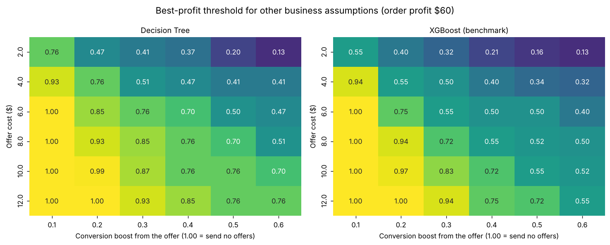

# Business threshold tuning

## The problem with 0.5

A model outputs a probability, say 0.37. To act on it we need a cutoff: target the session if its probability is at least the threshold. 0.5 is a convention, not a business decision. A lower threshold targets more sessions (more buyers found, more money wasted on non-buyers); a higher one targets fewer.

## The scenario

The shop shows a discount offer to every session the model flags as a likely buyer. Each outcome has a value:

| Outcome | Meaning | Profit per session |
|---|---|---|
| True positive | Flagged, really a buyer | `AVERAGE_ORDER_PROFIT x OFFER_CONVERSION_BOOST - OFFER_COST` |
| False positive | Flagged, did not buy | `-OFFER_COST` (offer wasted) |
| False negative | Not flagged, really a buyer | 0 (a missed sale: no extra profit, reported as "missed profit") |
| True negative | Not flagged, did not buy | 0 |

Total profit = TP x (TP value) + FP x (FP value). The threshold that maximises it is the **best-profit threshold**.

## The assumptions

At the top of [`predator/threshold.py`](../predator/threshold.py), clearly labelled as illustrative:

| Constant | Value | Meaning |
|---|---|---|
| `AVERAGE_ORDER_PROFIT` | $60 | Profit (not revenue) on an average order |
| `OFFER_COST` | $6 | Cost of one offer (discount plus delivery), paid for every targeted session |
| `OFFER_CONVERSION_BOOST` | 0.40 | Share of a targeted buyer's order profit credited to the offer: the fraction of these sales the offer wins or saves; the rest would have happened anyway |

With these numbers, a true positive is worth 60 x 0.40 - 6 = **$18** and a false positive costs **$6**. Targeting pays off when at least 1 in 4 targeted sessions is a buyer (precision above 0.25).

These are not facts from the dataset. The dataset has no prices or campaign results.

## How the threshold is chosen without touching the test set

1. During training we compute **out-of-fold probabilities**: every training session is predicted by a model trained on the other 4 folds.
2. We try every threshold from 0.01 to 0.99 on those probabilities and record profit, precision, recall and F1.
3. The thresholds with the highest F1 and the highest profit are picked.
4. Only then are 0.5, best-F1 and best-profit applied to the test set.

## Results on the test set (2,466 sessions)

| Model | Default 0.5 | Best F1 | Best profit |
|---|---|---|---|
| Decision Tree | 0.50: F1 0.627, $3,786 | 0.76: F1 0.660, $3,720 | **0.70: F1 0.659, $3,870** |
| KNN | 0.50: F1 0.469, $2,052 | 0.35: F1 0.471, $2,046 | 0.35: F1 0.471, $2,046 |
| KNN (undersampled) | 0.50: F1 0.517, $2,508 | 0.53: F1 0.533, $2,688 | 0.53: F1 0.533, $2,688 |
| Naive Bayes (baseline) | 0.50: F1 0.293, -$4,002 | 0.99: F1 0.296, -$3,840 | 0.99: F1 0.296, -$3,840 |
| XGBoost (benchmark) | **0.50: F1 0.645, $3,924** | 0.62: F1 0.671, $3,996 | 0.50: F1 0.645, $3,924 |

Full table: `outputs/threshold_comparison.csv`. Plot: `outputs/figures/profit_vs_threshold.png`.

## What we learned

- **The best threshold depends on calibration, not only on the business numbers.** The Decision Tree is trained with `class_weight="balanced"`, which inflates its probabilities; its best-profit threshold is 0.70, far above 0.5, and it earns more there while targeting 154 fewer sessions.
- **Best F1 and best profit are different goals.** F1 weighs a missed buyer and a false alarm equally. Our profit model makes a true positive worth three times what a false positive costs, so it prefers a slightly lower threshold than F1 does.
- **The profit curve is flat near its peak.** For XGBoost the training data put the best-profit threshold at 0.50, while on the test set 0.62 earned $72 more. Differences this small are within noise; any threshold on the plateau is a reasonable choice.
- **Naive Bayes loses money at every threshold.** Its probabilities sit at 0 or 1, so moving the cutoff barely changes who is targeted. The right business decision with that model is not to run the campaign.

## How sensitive is the threshold?

`threshold.run_sensitivity_analysis()` repeats the search for 36 combinations of offer cost ($2 to $12) and conversion boost (10% to 60%) on the same out-of-fold probabilities (`outputs/sensitivity_analysis.csv`).

- For the Decision Tree the best threshold ranges from 0.13 (cheap offer, strong boost) to 0.93, and with a 10% boost and an offer cost of $6 or more nothing is profitable: send no offers.
- The direction never changes: cheaper offers and stronger boosts mean a lower threshold.

## Calibrated probabilities make the threshold explainable

If the probabilities are calibrated, an offer to a session with purchase probability p earns `p x order profit x boost - offer cost` on average, which is positive when p > offer cost / (order profit x boost) = 6 / 24 = **0.25** (`threshold.break_even_probability()`).

The raw probabilities are not calibrated: balanced class weights push the Decision Tree's average to 0.28 against a real purchase rate of 0.155, which is why its tuned threshold is 0.70. After isotonic calibration (`predator/calibration.py`), the plain break-even rule earns $4,086 on the test set, more than the tuned 0.70 threshold on raw probabilities ($3,870). Details in [results.md](results.md#calibration).

## How to change the assumptions

1. Edit the three constants at the top of `predator/threshold.py`.
2. Run `python main.py`. The thresholds, the table, the plot and `models/model_info.json` are all refreshed.
3. The Streamlit app and `predict.py` pick up the new best-profit thresholds automatically. The app also has the three assumptions as inputs in its sidebar and re-tunes the threshold on the out-of-fold training probabilities as you change them, without re-running `main.py`.

Rule of thumb: targeting pays when precision > `OFFER_COST / (AVERAGE_ORDER_PROFIT x OFFER_CONVERSION_BOOST)`. A cheaper offer or a bigger boost lowers that bar and pushes the best threshold down; a more expensive offer pushes it up.
