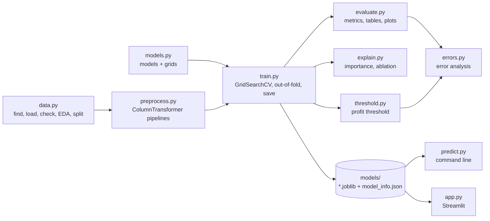

# Code guide

What each file does, its main functions, and how they connect.

## How the pieces connect

`main.py` calls the steps in order. `predict.py` and `app.py` only read what `main.py` saved.

## `predator/data.py`

| Function | What it does |
|---|---|
| `find_dataset()` | Returns the CSV path from `data/` or anywhere under `/kaggle/input/`, or `None` |
| `load_dataset(path=None)` | Reads the CSV, `Revenue` to 0/1; raises a friendly `FileNotFoundError` with download steps |
| `validate_dataset(data)` | Prints and returns missing values, duplicates, negatives, purchase rate; fails if a column is missing |
| `split_data(data)` | Stratified 80/20 split, returns `train_features, test_features, train_target, test_target` |
| `run_eda(data)` | Saves the class balance, distributions, purchase-rate and correlation plots |
| `save_figure(figure, filename)` | Saves a plot to `outputs/figures/` and closes it (used by every module) |

Also holds the shared constants: `NUMERICAL_FEATURES`, `CATEGORICAL_FEATURES`, `TARGET_COLUMN`, `RANDOM_STATE = 42`.

## `predator/preprocess.py`

| Function | What it does |
|---|---|
| `build_preprocessor(numerical, categorical, scale_numbers)` | `ColumnTransformer`: `StandardScaler` (or passthrough for trees) + `OneHotEncoder(handle_unknown="ignore")` |
| `build_pipeline(model, ...)` | `Pipeline([("preprocess", ...), ("model", model)])` |
| `get_feature_names(fitted_pipeline)` | Column names after one-hot encoding, e.g. `Month_Nov` |
| `undersample_training_data(features, target)` | All buyers plus an equal random sample of non-buyers |

## `predator/models.py`

Model name constants (`DECISION_TREE`, `KNN`, `KNN_UNDERSAMPLED`, `NAIVE_BAYES`, `XGBOOST`), their roles, colours and file names.

| Function | What it does |
|---|---|
| `make_decision_tree()`, `make_knn()`, `make_naive_bayes()`, `make_xgboost(scale_pos_weight)` | Create unfitted models; the docstrings explain each algorithm |
| `get_parameter_grids()` | The GridSearchCV grid for each model |
| `uses_scaling(model_name)` | `False` for the tree models |
| `make_model(model_name, scale_pos_weight)` | Create any model by name |

## `predator/train.py`

| Function | What it does |
|---|---|
| `tune_model(...)` | GridSearchCV (5-fold stratified, F1) for one model; undersamples first for the undersampled KNN |
| `out_of_fold_probabilities(...)` | Hand-written 5-fold loop: a probability for every training session from a model that did not see it |
| `train_all_models(train_features, train_target, ...)` | Tunes all five models, adds out-of-fold probabilities and CV F1 |
| `save_models(results)` | joblib save of the fitted pipelines (`predict.load_model_by_name()` loads one) |
| `save_model_info(info)` / `load_model_info()` | `models/model_info.json` for the app and CLI |

## `predator/evaluate.py`

| Function | What it does |
|---|---|
| `evaluate_model(...)` | Accuracy, precision, recall, F1, ROC-AUC, confusion matrix, report for one model |
| `build_comparison_table(...)` | All models in one table; saves `model_comparison.csv` and `classification_reports.txt` |
| `choose_best_model(table)` | Highest CV F1 |
| `plot_roc_curves`, `plot_confusion_matrices`, `plot_metric_comparison` | Result plots |

## `predator/explain.py`

| Function | What it does |
|---|---|
| `plot_tree_feature_importance(tree_pipeline)` | Impurity-based importance bar chart |
| `plot_top_of_tree(tree_pipeline, max_depth=3)` | Top levels of the trained tree |
| `permutation_importance_all_models(...)` | Permutation importance (ROC-AUC drop) on the 17 raw features for every model, heatmap + CSV |
| `run_ablation(...)` | Retrain everything without PageValues, compare scores and top features |
| `write_tree_vs_xgboost_comparison(...)` | Performance vs interpretability write-up with this run's numbers |
| `describe_decision_path(tree_pipeline, session)` | The plain-English rules one session followed (used by the app) |

## `predator/threshold.py`

Business assumptions at the top: `AVERAGE_ORDER_PROFIT`, `OFFER_COST`, `OFFER_CONVERSION_BOOST`.

| Function | What it does |
|---|---|
| `profit_per_outcome()` | Profit for a TP, FP, FN and TN |
| `calculate_profit(true_target, probabilities, threshold)` | Total profit and outcome counts at one threshold |
| `build_threshold_curve(...)` | Profit, precision, recall, F1 for thresholds 0.01 to 0.99 |
| `find_best_thresholds(curve)` | Best-F1 and best-profit thresholds |
| `tune_thresholds(...)` | Chooses thresholds on out-of-fold training data, compares 0.5 / best F1 / best profit on test |
| `plot_profit_curves(...)` | Profit and F1 against the threshold, per model |

## `predator/errors.py`

| Function | What it does |
|---|---|
| `label_prediction_groups(...)` | Tags each test session as caught buyer, missed buyer, false alarm or correct non-buyer |
| `summarise_numerical_features(sessions)` | Feature means per group |
| `summarise_categorical_feature(sessions, column)` | Category shares per group |
| `plot_error_analysis(...)`, `plot_probability_histogram(...)` | The error plots |
| `write_error_findings(...)` | Plain-English findings with this run's numbers |
| `run_error_analysis(...)` | Runs all of the above |

## `predator/predict.py`

| Function | What it does |
|---|---|
| `prepare_session(values)` | Dictionary of 17 features to a one-row DataFrame with the training types; names missing features |
| `load_session_from_json(path)` | Reads a session JSON file |
| `predict_session(pipeline, session, threshold)` | Label, probability, threshold decision |
| `load_model_by_name(name, model_info)` | Loads one saved pipeline |
| `main()` | The command line: `python -m predator.predict FILE [--model NAME]` |

## Other files

| File | Purpose |
|---|---|
| `main.py` | Runs the whole pipeline; `build_model_info()` collects what the app needs |
| `app.py` | Streamlit demo: prediction page (inputs, probability bar, decision, importance, decision path) and comparison page |
| `examples/*.json` | Two real test-set sessions (a buyer and a browser) for the CLI and the app |
| `tests/` | pytest: data loads, pipelines fit, prediction output is valid, profit and threshold logic |
| `scripts/build_notebooks.py` | Builds both notebooks from one story; the Kaggle one gets the package source inline |
| `notebooks/predator_walkthrough.ipynb` | Walkthrough that imports the package |
| `kaggle/predator-kaggle.ipynb` | Self-contained Kaggle version |

## Changing the code

After editing anything in `predator/`, rebuild the notebooks so the Kaggle copy matches: `python scripts/build_notebooks.py`. Then `pytest -q` and `python main.py`.
