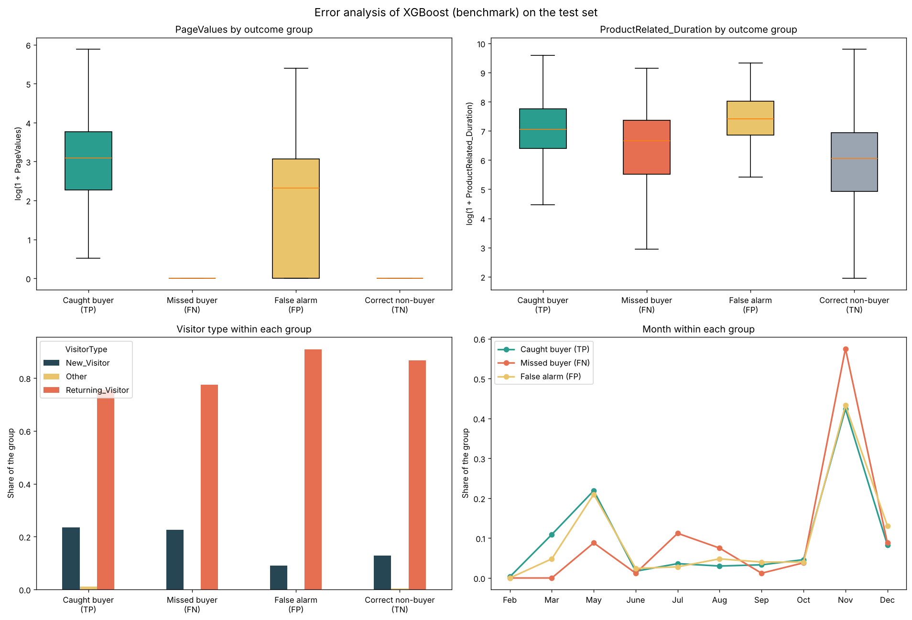
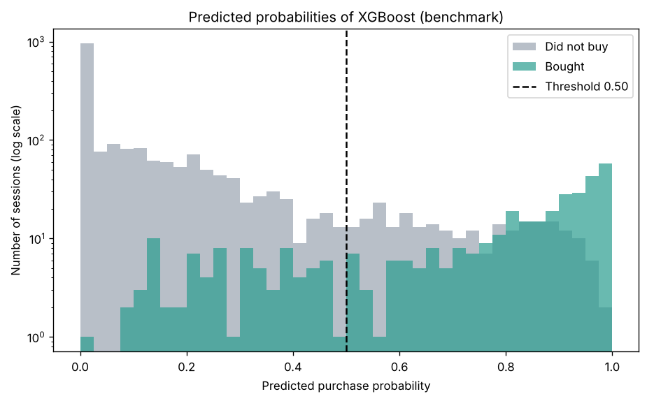

# Error analysis

**Model:** XGBoost (benchmark), the best model by cross-validated F1, at its best-profit threshold of 0.50, on the 2,466 test sessions.

Code: [`predator/errors.py`](../predator/errors.py). Generated outputs: `outputs/error_analysis.md`, `outputs/error_numerical_summary.csv`, `outputs/error_categorical_summary.csv`, `outputs/figures/error_analysis.png`, `outputs/figures/error_probability_histogram.png`.

## The four groups

| Group | Sessions | Mean PageValues | Share with PageValues = 0 | Median product time (s) | Mean ExitRates | Mean predicted probability |
|---|---|---|---|---|---|---|
| Caught buyer (TP) | 302 | 31.6 | 7% | 1,148 | 0.019 | 0.86 |
| Missed buyer (FN) | 80 | 1.0 | 80% | 781 | 0.033 | 0.29 |
| False alarm (FP) | 252 | 16.0 | 25% | 1,662 | 0.022 | 0.72 |
| Correct non-buyer (TN) | 1,832 | 0.2 | 97% | 424 | 0.049 | 0.09 |

The model finds 79% of buyers (302 of 382). Of the sessions it flags, 55% buy.

## What the missed buyers have in common

- **No page-value trail.** 80% of missed buyers have PageValues = 0, against 7% of caught buyers. Their mean PageValues (1.0) is closer to the correct non-buyers (0.2) than to caught buyers (31.6). PageValues is by far the model's strongest feature, so these buyers look like ordinary browsers.
- **Less engagement.** Median time on product pages is 781 s against 1,148 s for caught buyers, and the exit rate is higher (0.033 vs 0.019). They sit between buyers and non-buyers on every behaviour measure.
- **Visitor type is not the reason.** 22% of missed buyers are new visitors, about the same as caught buyers (24%).
- **November is over-represented:** 57% of missed buyers against 42% of caught buyers. In the busy pre-holiday season more people buy quickly without the browsing pattern the model has learned.

## What the false alarms have in common

- **They look like buyers.** Mean PageValues 16.0 and only 25% with PageValues = 0; they spend even longer on product pages (median 1,662 s) than real buyers.
- **Returning visitors.** 91% of false alarms are returning visitors, against 76% of caught buyers: people who come back, browse valuable pages, and still leave without paying (comparison shopping, abandoned carts).
- **December is over-represented:** 13% of false alarms against 8% of caught buyers.

## Why the model struggles with them

The dataset records how a session behaved, not why. Two kinds of session break the main pattern:

1. **Decided buyers.** Someone who already knows what they want arrives, buys and leaves. They never pass through the pages that give a high PageValues, so the strongest signal says "no".
2. **Window shoppers.** Someone who browses product pages, fills a cart and leaves produces exactly the trail of a buyer.

With PageValues dominating, the errors are mostly the sessions where PageValues points the wrong way. The predicted-probability histogram shows the overlap: missed buyers sit among the non-buyers at low probabilities, false alarms among the buyers at high ones.

## What would help

More tuning will not fix this; the information is not in the 17 features. Useful additions would be the visitor's purchase history, cart contents and whether they reached the checkout page. From a business angle, false alarms are cheap ($6 each under our assumptions) while caught buyers are worth $18, which is why the best-profit threshold accepts them.
