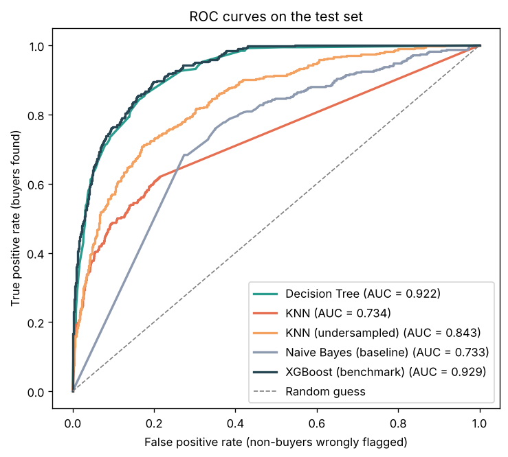
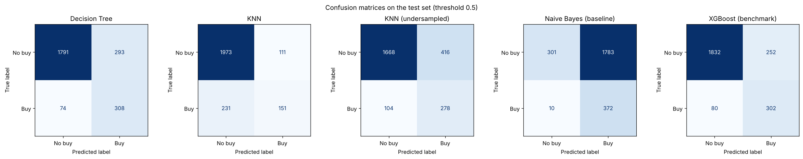
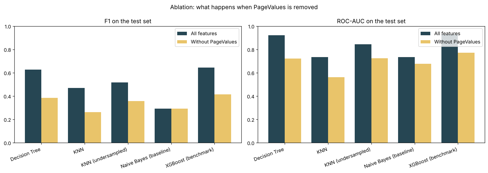
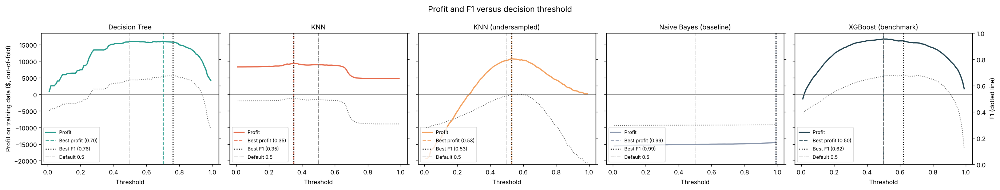

# Results

All numbers come from `python main.py` with `random_state=42`: 9,864 training sessions, 2,466 test sessions, 15.5% buyers in both. Tables are in `outputs/`, figures in `outputs/figures/`.

## Model comparison (test set, threshold 0.5)

| Model | Role | CV F1 | Accuracy | Precision | Recall | F1 | ROC-AUC |
|---|---|---|---|---|---|---|---|
| Decision Tree | Main (course) | 0.642 | 0.851 | 0.512 | 0.806 | 0.627 | 0.922 |
| KNN | Main (course) | 0.493 | 0.861 | 0.576 | 0.395 | 0.469 | 0.734 |
| KNN (undersampled) | Main (course) | 0.521 | 0.789 | 0.401 | 0.728 | 0.517 | 0.843 |
| Naive Bayes | Baseline | 0.299 | 0.273 | 0.173 | 0.974 | 0.293 | 0.733 |
| **XGBoost** | **Benchmark (beyond course)** | **0.673** | 0.865 | 0.545 | 0.791 | **0.645** | **0.929** |

CV F1 is the 5-fold cross-validated F1 on the training data at the real class balance, and is what the best model is chosen by.

**Takeaways**

- **XGBoost (benchmark)** is the best model; the **Decision Tree** is the best main model and reaches 97% of XGBoost's F1 and 99% of its ROC-AUC.
- Plain **KNN** has the highest accuracy after XGBoost (0.861) but finds only 40% of buyers: a clear example of accuracy hiding a weak model on imbalanced data.
- **Undersampling** helps KNN: recall 0.40 to 0.73, F1 0.469 to 0.517, ROC-AUC 0.734 to 0.843.
- **Naive Bayes** flags 87% of sessions as buyers and has an accuracy of 0.273, worse than always saying "no".

## Best hyperparameters

| Model | Best settings |
|---|---|
| Decision Tree | criterion = entropy, max_depth = 7, min_samples_split = 50, min_samples_leaf = 20 |
| KNN | n_neighbors = 3, weights = distance, metric = euclidean |
| KNN (undersampled) | n_neighbors = 27, weights = distance, metric = manhattan |
| XGBoost | n_estimators = 100, max_depth = 6, learning_rate = 0.1 |

## Feature contributions

Permutation importance (drop in test ROC-AUC when a feature is shuffled):

| Feature | Decision Tree | KNN | KNN (undersampled) | Naive Bayes | XGBoost |
|---|---|---|---|---|---|
| PageValues | 0.318 | 0.156 | 0.136 | 0.055 | 0.300 |
| Month | 0.065 | 0.008 | 0.022 | 0.024 | 0.073 |
| ExitRates | 0.003 | 0.005 | 0.007 | 0.031 | 0.016 |

PageValues is the most important feature for every model, by a wide margin. Month (mostly November) is second for the tree-based models. The Decision Tree's first split is `PageValues <= 0.05`.

## Decision Tree vs XGBoost

| | Decision Tree | XGBoost (benchmark) |
|---|---|---|
| Test F1 / ROC-AUC | 0.627 / 0.922 | 0.645 / 0.929 |
| Size | 1 tree, depth 7, 63 leaves | 100 trees, depth up to 6 |
| Explaining one prediction | Print its path of questions | Needs outside tools |

XGBoost is slightly more accurate because boosting combines many trees that correct each other's errors and gives smoother probabilities. The Decision Tree can be read as a flowchart, and the app prints the exact path any session takes. For a shop team that must understand and trust the rules, the small loss in score is worth the transparency. Full text: `outputs/tree_vs_xgboost.md`.

## Ablation: without PageValues

| Model | F1 all features | F1 without | Change | ROC-AUC all | ROC-AUC without | Change |
|---|---|---|---|---|---|---|
| Decision Tree | 0.627 | 0.384 | -0.243 | 0.922 | 0.721 | -0.201 |
| KNN | 0.469 | 0.261 | -0.208 | 0.734 | 0.562 | -0.172 |
| KNN (undersampled) | 0.517 | 0.356 | -0.161 | 0.843 | 0.723 | -0.120 |
| Naive Bayes | 0.293 | 0.292 | -0.001 | 0.733 | 0.678 | -0.055 |
| XGBoost | 0.645 | 0.414 | -0.231 | 0.929 | 0.772 | -0.157 |

Without PageValues the Decision Tree, KNN and XGBoost lose a third or more of their F1. Naive Bayes barely changes because it was already flagging almost everyone. The new top features are behaviour signals: **ExitRates**, **ProductRelated_Duration**, **ProductRelated** and **Month** for the trees, and **Month**, **VisitorType** and **TrafficType** for KNN (`outputs/ablation_top_features.csv`). They carry real information (XGBoost still reaches ROC-AUC 0.772) but cannot replace the page-value signal.

## Business threshold

With an $18 gain per true positive and a $6 loss per false positive (illustrative assumptions):

- The **Decision Tree** earns most at threshold **0.70**: $3,870 on the test set against $3,786 at 0.5, while targeting 447 sessions instead of 601.
- **XGBoost** earns $3,924 at 0.5 (its training-data optimum) and $3,996 at its best-F1 threshold of 0.62; the profit curve is flat near the top.
- **Naive Bayes** loses money at every threshold.

Details: [business_threshold.md](business_threshold.md).

## Error analysis

The best model misses 80 of 382 test buyers. 80% of them have PageValues = 0 and they spend less time on product pages; November is over-represented. The 252 false alarms look like buyers (high PageValues, long product-page time) and 91% are returning visitors. Details: [error_analysis.md](error_analysis.md).

## Conclusions

1. **PageValues drives purchase prediction.** It is the top feature for every model, the root of the Decision Tree, and removing it costs a third or more of F1.
2. **The Decision Tree is the recommended course model**: close to the XGBoost benchmark and fully interpretable.
3. **XGBoost is the strongest benchmark**, by a small margin.
4. **KNN needs balancing and suffers from many dimensions; Naive Bayes' assumptions do not hold here.**
5. **The decision threshold is a business choice**; with a profit model it differs from 0.5 and from the best-F1 threshold.
6. **The remaining errors are sessions whose behaviour contradicts their outcome**, which more visitor data could fix and more tuning cannot.
